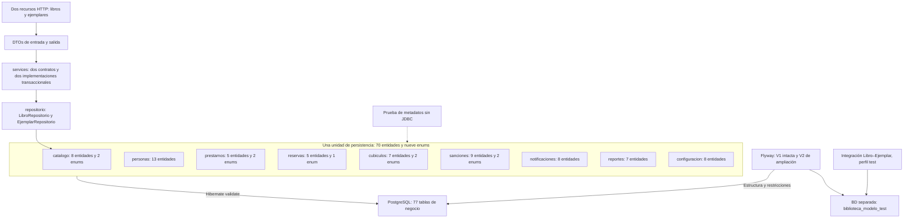

# Plan por capas y arquitectura de la entrega

## Acuerdo vigente

Modelo completo autorizado: 70 entidades JPA, nueve enums, una unidad de persistencia y todas sus tablas mediante V1/V2. Repositorios, servicios, DTOs y controladores operativos se conservan en Libro–Ejemplar. No hay nuevas API de personas, circulación, sanciones, notificaciones, reportes o configuración.

El gráfico representa dependencias técnicas y alcance. Las asociaciones entre entidades están en la [matriz](MATRIZ_MODELO_COMPLETO.md); no representan servicios ya implementados.

## Responsabilidad por capa

| Capa / recurso | Responsabilidad actual |
|---|---|
| modelo/modulo | Atributos, asociaciones, claves, enums y JPA con fuentes en Javadoc |
| Flyway | Estructura y restricciones; V2 amplía las dos tablas de V1 y añade 75 |
| repositorio | Guardar/consultar Libro y Ejemplar; sin políticas de circulación |
| services e impl | Alta y consulta del circuito piloto, validación de existencia/duplicados y transacciones |
| dto | Entrada/salida del circuito; no serializar entidades directamente |
| controlador | Validar y delegar; dos recursos y cinco operaciones HTTP |
| excepcion | Errores del circuito HTTP |
| Pruebas | Metadatos completos sin BD y funciones Libro/Ejemplar con BD separada |

## Verificación de esta entrega

1. Contrastar atributos/relaciones con PDF y diagrama, citando módulo, páginas y RF/RN; registrar decisiones expresas.
2. Revisar 70 entidades y nueve enums: herencia, extremos, nullabilidad, unicidad, longitudes, alias y uniones.
3. Conservar V1 y revisar V2/77 tablas declaradas, sin otra unidad persistente.
4. Compilar y construir metadatos cuando las dependencias y el entorno lo permitan. Una comprobación sin JDBC no prueba PostgreSQL.
5. Ejecutar integración en biblioteca_modelo_test con ambas migraciones cuando haya acceso autorizado. Modificar datos solo de Libro/Ejemplar.
6. Registrar resultados reales, impedimentos y capturas en PRUEBA_Y_EVIDENCIAS.md.

Cada resultado requiere evidencia. Los impedimentos de Maven/PostgreSQL no autorizan cambiar permisos, red o destino por rutas alternativas.

## Trabajo funcional futuro

| Módulo | Casos de uso pendientes |
|---|---|
| M01 | Registro de personas/cuentas, verificación, autenticación, permisos y visitas |
| M02 | Catálogos restantes, ubicación e historial automático, normalización ISBN completa |
| M03 | Préstamos, devoluciones parciales, renovaciones y política aplicada inmutable |
| M04 | Prioridad, asignación/liberación, vencimientos y exclusividad vigente |
| M05 | Calendario efectivo, solapamientos, tolerancias, asistencia y ocupación |
| M06 | Sanciones, multas, pagos, saldos, reposiciones y restricciones efectivas |
| M07 | Plantillas ejecutables, destinatarios, preferencias obligatorias y envíos |
| M08 | Consultas, indicadores, generación/exportación de archivos y programación |
| M09/M10 | Parámetros, auditoría automática, sesiones reales, incidentes y respaldos |

Las unidades de algunos parámetros y sus valores institucionales siguen pendientes. Campos de condiciones/historial no implementan por sí solos reglas, inmutabilidad, seguridad o cambios automáticos. Cambios posteriores de esquema requieren otra migración aprobada; no se reescriben migraciones ya aplicadas.
